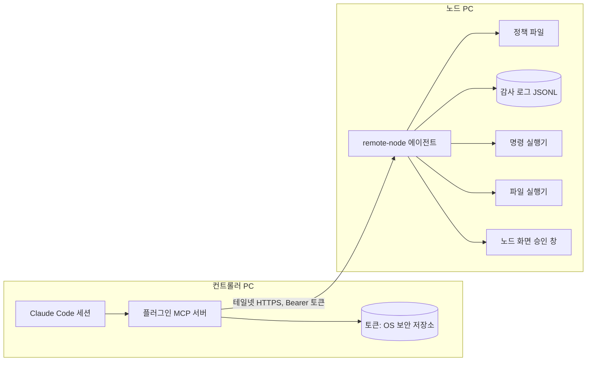
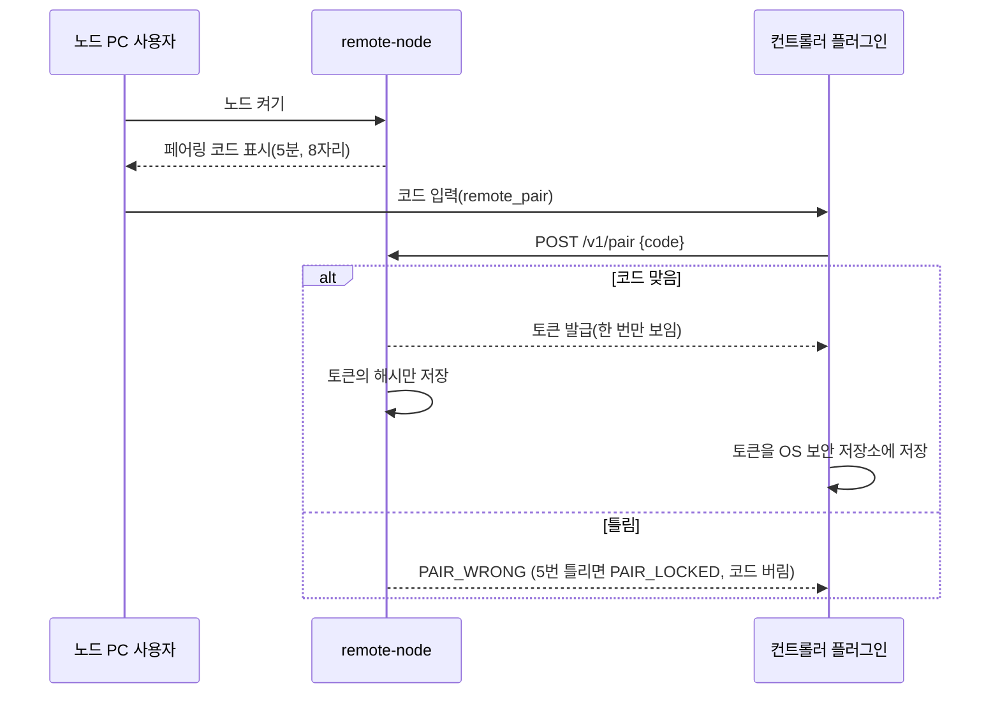
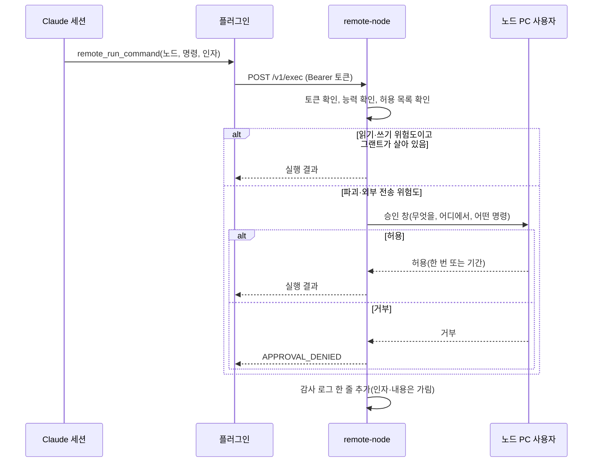
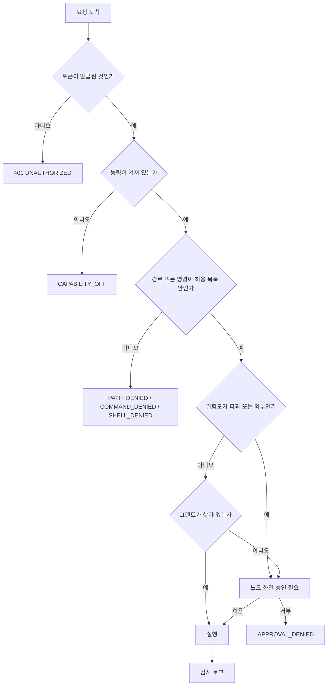

# remote-computer-use 설계 (v0.1)

상태: v0.1 확정. M1 구현 중. v0 초안과 달라진 점은 17장에 모았고, 충돌하면 17장이 우선입니다.
대상: 맥과 윈도우 PC 사이에서, 한 쪽의 AI 세션(Claude Code, Codex, 클라우드 세션)이 다른 쪽 PC의 명령·파일·화면을 다루는 도구. Claude Code 플러그인과 Codex 스킬로 배포한다.

## 1. 목적과 범위

- 목적: 로컬 세션이 원격 PC를 조작하고, 원격 세션이 내 PC를 조작할 수 있게 한다.
- 두 방향을 같은 구조로 다룬다. 각 PC는 역할이 같다(노드). 조종하는 쪽은 컨트롤러다.
- 범위(v0): 명령 실행, 파일 읽기·쓰기, 노드 정보. 화면 읽기와 입력은 v1 이후다.
- 범위 밖: 여러 사람이 쓰는 공유 서버, 인터넷에 공개하는 접속, 자동 업데이트, 클라우드 중계.

## 2. 용어

- **컨트롤러**: `rcu` CLI를 Bash로 부르는 AI 세션. 명령을 보낸다.
- **노드**: 조작당하는 PC에서 도는 작은 에이전트. 허용된 일만 한다.
- **테일넷**: 이 프로젝트의 전송 경계. 노드는 테일스케일 IP에서만 듣는다.
- **그랜트**: 특정 노드에 특정 능력을 특정 기간 허용하는 기록.

## 3. 구조

```
[컨트롤러 세션]                          [노드 PC]
 Claude Code                              remote-node (에이전트)
  └ Bash → rcu CLI + 스킬  ── HTTP/테일넷 ──▶  ├ 인증·그랜트 검사
                                          ├ 능력별 실행기 (exec, fs, 나중에 screen·input)
                                          └ 감사 로그 (추가 전용)
```

- **`rcu`**: Rust 단일 실행 파일 하나가 노드(`rcu serve`)와 컨트롤러(`rcu pair|info|nodes|…`)를 겸한다. MCP는 쓰지 않는다. 에이전트는 Bash로 `rcu`를 부르고, 스킬(`SKILL.md`)이 사용법과 승인 규칙을 가르친다.
- 맥·윈도우·리눅스에 같은 바이너리와 같은 프로토콜. 두 PC 모두 노드이면서 컨트롤러가 될 수 있다.
- 노드는 기본적으로 **꺼져 있다**. 사용자가 노드 PC에서 명시적으로 켠다.

## 4. 노드 프로토콜 v0

모든 요청은 테일넷 주소의 HTTP로 간다(구간 암호화는 테일스케일 WireGuard가 맡는다). `/v1/pair`를 뺀 모든 요청은 Bearer 토큰과 노드 측 정책·그랜트 검사를 거친다.

| 메서드 | 경로 | 능력 | 설명 |
|---|---|---|---|
| GET | /v1/info | 없음(토큰은 필요) | 노드 이름, OS, 에이전트 버전, 켜 둔 능력 목록 |
| POST | /v1/exec | exec | 허용 목록의 명령만 실행(셸 없이 인자 배열로) |
| POST | /v1/fs/read | fs.read | 허용 경로 안의 파일 읽기(크기 상한) |
| POST | /v1/fs/write | fs.write | 허용 경로 안에 쓰기(기본은 새 파일만, 덮어쓰기는 별도 승인) |
| POST | /v1/pair | 없음 | 첫 연결용 페어링(노드 화면에 짧은 코드 표시) |

v1 예정(이번 범위 아님): /v1/screen/capture, /v1/input/*.

응답은 JSON. 오류는 `{code, message}`로 주고, 비밀값과 경로 전체는 오류 문장에 넣지 않는다.

## 5. 권한 모델

**능력 분류**
- `info`: 읽기만. 기본 켜짐.
- `exec`: 명령 실행. 기본 꺼짐.
- `fs.read`: 허용 경로 읽기. 기본 꺼짐.
- `fs.write`: 허용 경로 쓰기. 기본 꺼짐.
- `screen`, `input`: v1에서 추가. 기본 꺼짐.

**위험도**
- `read`: 상태 확인, 파일 읽기.
- `write`: 파일 생성, 명령 실행.
- `destructive`: 삭제, 덮어쓰기, 설정 변경, 권한 변경. 항상 승인.
- `external`: 네트워크 전송(메일, 메신저, 업로드). 항상 승인.

**규칙**
1. 기본은 거부다. 노드 설정 파일에 적힌 것만 허용한다.
2. 명령은 허용 목록(실행 파일 경로와 인자 패턴)으로 제한한다. 셸(`sh -c`, `cmd /c`, PowerShell 문자열 실행)은 허용하지 않는다.
3. 파일 경로는 허용 루트 아래로만 정규화 후 검사한다(심볼릭 링크와 `..` 우회를 막는다).
4. `destructive`와 `external`은 노드 쪽 확인 없이는 실행하지 않는다. 승인은 노드 화면 또는 노드 사용자의 명시적 응답으로 받는다.
5. 그랜트는 기간이 있다(기본 1시간). 만료되면 다시 승인을 받는다.

## 6. 승인 흐름

1. 컨트롤러가 `remote_run_command` 같은 도구를 부른다.
2. 노드가 정책으로 위험도를 정한다.
3. `read`/`write`이고 그랜트가 살아 있으면 바로 실행한다.
4. 그 밖이면 노드가 승인 요청을 만든다. 노드 PC 화면에 무엇을 할지, 어느 경로·명령인지 보여 준다.
5. 노드 사용자가 허용하면 한 번만 또는 기간 동안 허용한다. 거부하면 컨트롤러에 거부 오류를 준다.

컨트롤러 쪽은 승인이 필요하다는 사실을 사용자에게 보여 주고, 승인이 끝나기 전에는 같은 요청을 반복하지 않는다.

## 7. 페어링과 인증

- 노드를 처음 켜면 짧은 페어링 코드를 노드 화면에 띄운다.
- 컨트롤러는 그 코드로 `pair`를 호출해 노드별 토큰을 받는다.
- 토큰은 OS 보안 저장소(맥 키체인, 윈도우 자격 증명 관리자). 보안 저장소가 없는 리눅스·클라우드 컨테이너는 환경 시크릿 `RCU_TOKEN_<노드이름>`만 쓴다에 둔다. 평문 파일에 두지 않는다.
- 토큰은 노드마다 다르고, 폐기할 수 있다. 노드 쪽에서 언제든 모든 토큰을 지우는 명령을 둔다.
- 테일넷 밖에서는 접속이 안 되도록 노드는 테일스케일 주소에서만 듣는다.

## 8. 위협 모델

| 위협 | 대응 |
|---|---|
| 화면·파일 글에 든 프롬프트 인젝션 | 화면과 파일 내용은 데이터로만 다룬다. 명령으로 바꾸는 것은 항상 정책과 승인을 거친다. |
| 토큰 탈취 | 보안 저장소 보관, 노드별 토큰, 폐기 명령, 그랜트 기간 제한 |
| 테일넷 계정 침해 | 노드별 페어링 필수, 노드 쪽 승인 필수(토큰만으로 파괴 작업 불가) |
| 명령 주입 | 셸 미사용, 인자 배열, 허용 목록 |
| 경로 우회 | 정규화, 허용 루트 밖 거부, 심볼릭 링크 해석 후 검사 |
| 폭주(반복 호출) | 노드별 속도 제한과 1일 호출 상한 |
| 비밀값 노출 | 키체인 값과 비밀 파일을 허용 루트에서 제외, 응답·로그에서 자동 가림 |
| 되돌리기 어려운 행동 | `destructive`는 항상 승인, 덮어쓰기 전에 백업 |

## 9. 감사 로그

- 노드마다 추가 전용 JSON Lines 파일 하나.
- 기록: 시각, 요청 id, 능력, 명령 또는 경로(가림 처리), 위험도, 승인 결과, 결과 코드, 소요 시간.
- 기록하지 않음: 파일 내용, 명령의 표준 출력 전문, 토큰, 비밀값.
- 로그는 노드 PC에 남고, 사용자가 언제든 볼 수 있다.
- 보관 기간 기본 30일, 자동 정리.

## 10. OS별 고려

- **맥**: 파일 접근과 실행은 권한 문제가 적다. v1 화면 조작에는 손쉬운 사용과 화면 기록 권한이 필요하다. launchd로 노드를 백그라운드에서 띄운다(사용자 로그인 세션 한정).
- **윈도우**: 사용자 세션에서 도는 것이 기본이다(서비스로 띄우면 화면 조작이 막힌다). UAC 권한이 필요한 작업은 범위 밖으로 둔다. 설치 파일은 기존 오토브릭처럼 NSIS를 쓰고, 설치 크기를 작게 유지한다.

## 11. 구현 구성

| 부분 | 기술 | 위치(예정) |
|---|---|---|
| `rcu` (노드 + 컨트롤러 CLI) | Rust (단일 실행 파일) | `src/` |
| Claude Code 플러그인·마켓 | `.claude-plugin/marketplace.json`, `plugin/` (스킬) | 루트, `plugin/` |
| Codex 스킬 | 같은 `SKILL.md`를 복사하는 설치 스크립트 | `scripts/` |
| 프로토콜 정의 | JSON 스키마, 오류 코드 | `proto/` |
| 시험 | 정책 단위 시험, 루프백 통합 시험 | `tests/` |

CLI 명령:
- 노드: `rcu serve`, `rcu revoke --all`, `rcu policy-check`
- 컨트롤러: `rcu nodes`, `rcu pair`, `rcu info` (M1) / `rcu exec`, `rcu read`, `rcu write`, `rcu wait`, `rcu grants` (M2~M3)

## 12. 로드맵

- **M0 설계**: 이 문서 검토(지금).
- **M1 노드 골격**: `/v1/info`, 페어링, 정책 파일, 감사 로그. 맥에서 먼저, 자기 자신을 노드로 쓴 통합 시험.
- **M2 명령과 파일**: `/v1/exec`, `/v1/fs/read`, `/v1/fs/write`, 승인 흐름(노드 화면 대화상자는 M2에서는 임시로 터미널 입력).
- **M3 플러그인**: MCP 도구 연결, 노드 목록 관리.
- **M4 윈도우 노드**: 같은 프로토콜을 윈도우 PC에서 실행. 설치 파일 빌드.
- **M5 화면과 입력(v1)**: 스크린샷, 클릭, 입력. 승인 게이트를 필수로 둔다.

각 단계는 시험이 통과해야 다음으로 넘어간다.

## 13. 열린 질문

1. 플러그인 배포: **결정 — 이 레포를 개인 마켓으로.** (`/plugin marketplace add jay-hyun/remote-computer-use`)
2. 승인 UI: 미정. M2는 노드 터미널 입력, 이후 결정.
3. 화면 캡처(v1)를 디스크에 남길지, 메모리에서만 쓰고 버릴지.
4. 맥과 윈도우 노드를 먼저 만들 PC 순서. 현재 윈도우 PC는 SSH가 꺼져 있다(설정 필요).
5. 노드 이름과 페어링 코드의 형식: **결정 — 이름은 정책 파일의 `node.name`, 코드는 8자 Crockford base32.**

## 14. 이번 설계에서 하지 않는 것

- 여러 명이 같은 노드를 공유하는 기능.
- 노드 간 직접 통신(컨트롤러를 거쳐서만).
- 인터넷 공개 접속과 중계 서버.
- 자동으로 노드를 설치하는 기능(사용자가 직접 설치한다).

## 15. 설계도

### 15.1 전체 구조



### 15.2 페어링



### 15.3 명령 실행과 승인



### 15.4 노드의 허용 판단 순서



### 15.5 마일스톤 흐름


## 16. 클라우드 세션 인계

이 문서는 구현 전 설계만 담습니다. 실제 빌드는 GitHub 클라우드 세션에서 하는 것으로 정했습니다.

**인계할 것**
- 이 문서 전체(특히 4장 프로토콜, 5장 권한 모델, 15장 설계도).
- 노드 언어는 Rust, 컨트롤러 플러그인은 TypeScript MCP 서버(11장).

**클라우드 세션이 먼저 할 것**
1. M1 범위만 구현: `/v1/info`, `/v1/pair`, 정책 파일 읽기, 감사 로그, 토큰 해시 저장.
2. 정책 시험부터 쓴다: 기본 거부, 경로 `..` 거부, 심볼릭 링크 우회 거부, 셸 거부, 명령 허용 목록. 이 항목들이 통과하기 전에는 M2로 넘어가지 않는다.
3. 바인드 주소는 루프백 또는 테일스케일 주소(100.64.0.0/10, fd7a:115c:a1e0::/48)만 허용한다.

**결정 완료**
- 플러그인 배포 방식: 개인 마켓(17장).
- 노드 설정 파일의 위치와 이름 규칙: 17장 3절.

**결정이 끝날 때까지 하지 않을 것**
- 화면 조작(v1)과 윈도우 노드 빌드.

## 17. v0.1 확정 사항 (v0 대비 변경)

### 17.1 MCP 대신 CLI + 스킬
- 컨트롤러는 MCP 서버가 아니라 `rcu` CLI다. 에이전트가 Bash로 부르고 스킬이 규칙을 가르친다. Claude Code와 Codex가 같은 `SKILL.md`를 쓴다.
- TypeScript 구성 요소는 없다. 노드와 컨트롤러가 한 Rust 바이너리다.

### 17.2 CLI 계약 (에이전트용)
- 표준 출력은 JSON 객체 하나. 실패는 `{"error":{"code","message"}}`.
- 종료 코드: `0` 성공, `1` 기타, `2` 정책 거부(`CAPABILITY_OFF`, `PATH_DENIED`, `COMMAND_DENIED`, `SHELL_DENIED`, `APPROVAL_DENIED`, `ADDRESS_DENIED`), `3` 승인 대기(`approval_id` 포함, M2), `4` 인증(`UNAUTHORIZED`, `PAIR_WRONG`, `PAIR_LOCKED`, `PAIR_EXPIRED`), `5` 네트워크.
- 승인이 필요하면 CLI가 최대 60초 기다린다. 그 안에 응답이 없으면 exit 3과 `approval_id`를 돌려주고, `rcu wait <id>`로 이어서 기다린다. 같은 요청을 다시 보내지 않는다.

### 17.3 파일 위치
기준 디렉터리는 `RCU_HOME`, 없으면 OS 설정 디렉터리 아래 `rcu`(맥 `~/Library/Application Support/rcu`, 리눅스 `~/.config/rcu`, 윈도우 `%APPDATA%\rcu\config`).
- 노드: `policy.toml`, `state/tokens.json`(SHA-256 해시만, 0600), `audit/YYYY-MM-DD.jsonl`(30일 지나면 `rcu serve` 시작 때 삭제)
- 컨트롤러: `nodes.toml`(이름과 주소만. 토큰 없음)

### 17.4 전송과 주소
- 노드는 루프백, 100.64.0.0/10, fd7a:115c:a1e0::/48 주소에서만 듣는다. 그 밖의 주소는 시작을 거부한다.
- 컨트롤러도 같은 대역이 아닌 주소로는 토큰을 보내지 않는다(`ADDRESS_DENIED`). 이름은 풀어서 모든 결과가 허용 대역일 때만 쓰고, 검사한 IP로 직접 접속한다.
- HTTPS는 쓰지 않는다. 테일넷이 구간을 암호화한다. 필요하면 `tailscale serve`로 감싼다.

### 17.5 정책 파일 (`policy.toml`)
```toml
[node]
name = "mac-home"

[capabilities]          # 모두 기본 false
exec = false
fs_read = false
fs_write = false

[fs]
roots = ["~/work"]
deny  = ["**/.env", "**/.ssh/**"]
max_read_bytes = 1048576

[[exec.allow]]
program = "/usr/bin/git"          # 절대 경로만
args    = ["status", "*"]          # "*" 인자 하나, 마지막 "**" 나머지 전부(0개 이상)
risk    = "read"                   # read | write | destructive | external
```
- 위험도는 노드의 정책 파일이 정한다. 컨트롤러가 보낸 값은 믿지 않는다.
- 셸(`sh`, `bash`, `zsh`, `cmd`, `powershell`, `pwsh`, `osascript`, `.bat`, `.cmd` 등)과 래퍼(`env`, `sudo`, `xargs` 등)는 허용 목록에 넣을 수 없고, 심볼릭 링크로 셸을 가리켜도 거부한다.
- 허용 목록에 `python`, `node`, `find`, `git` 같은 임의 실행이 가능한 프로그램을 넣는 것은 운영자 책임이다. 인자 패턴을 좁게 쓴다.
- 경로: 절대 경로만, `..` 포함 시 거부, 심볼릭 링크를 풀어 허용 루트 안인지 확인한 뒤 `deny` 패턴을 검사한다. 새 파일은 부모 디렉터리를 풀어서 검사한다. 정책 파일이 없으면 모두 꺼진 기본 정책이다.
- 알려진 한계: 검사와 실제 열기 사이의 경쟁(TOCTOU)은 M2에서 열린 파일 기준으로 다시 확인한다. 윈도우의 대소문자 구분 없는 경로 비교도 M4에서 다룬다.

### 17.6 그랜트
- 그랜트가 없으면 첫 요청도 승인이 필요하다. 승인할 때 "한 번" 또는 "기간(기본 1시간)"을 고른다. 기간 승인이 그랜트가 된다.
- `destructive`·`external`은 그랜트가 있어도 매번 승인한다. 이미 있는 파일 덮어쓰기는 `destructive`다.

### 17.7 페어링과 토큰
- 코드는 8자(Crockford base32, 사람이 O/I/L을 틀리게 쳐도 보정), 5분, 5번 틀리면 `PAIR_LOCKED`로 잠기고 코드를 버린다. 성공하면 코드를 소모한다. 노드 터미널에서 Enter를 치면 새 코드가 나온다.
- 토큰은 `rcu_` + 32바이트 무작위(base64url). 노드는 해시만 저장하고, 요청마다 상수 시간 비교로 확인한다. `rcu revoke --all`은 실행 중인 노드에도 바로 적용된다.
- `/v1/info`도 토큰이 필요하다(OS·능력 목록 노출 방지).
- 속도 제한과 1일 호출 상한은 M2에서 exec/fs와 함께 넣는다.

### 17.8 클라우드 세션을 컨트롤러로
- 컨테이너에서 `tailscaled --tun=userspace-networking --socks5-server=localhost:1055`로 테일넷에 들어간다. 인증 키는 환경 시크릿(에페메랄·태그 키 권장). `rcu`의 `RCU_PROXY=socks5://localhost:1055` 지원은 M3.
- 컨테이너 네트워크 정책에 테일스케일 제어 서버와 DERP 중계 접속이 열려 있어야 한다.
- 컨테이너에는 OS 보안 저장소가 없으므로 토큰은 환경 시크릿 `RCU_TOKEN_<노드이름>`으로 준다. 토큰은 사람이 `rcu pair <이름> <주소> <코드> --print-token`을 직접 실행해 얻고 시크릿에 넣는다(에이전트가 실행하면 토큰이 대화에 남는다).
- 방어선은 같다. 클라우드 컨트롤러도 노드의 정책과 노드 쪽 승인을 거친다.

### 17.9 배포
- 이 레포가 Claude Code 개인 마켓이다: `/plugin marketplace add jay-hyun/remote-computer-use`, `/plugin install remote-computer-use@remote-computer-use`.
- Codex는 `scripts/install-codex-skill.sh`가 `SKILL.md`를 `~/.codex/skills/remote-computer-use/`에 복사한다.
- `rcu` 바이너리는 사용자가 직접 설치한다(`cargo install --path .`). 스킬은 `rcu`가 PATH에 없으면 설치 방법을 안내하고 멈춘다.

### 17.10 마일스톤 갱신
- **M1 (구현됨)**: `/v1/info`, `/v1/pair`, 정책 파서와 판단 함수, 바인드 검사, 페어링, 토큰 해시 저장, 감사 로그, `rcu serve|revoke|policy-check|pair|info|nodes`, 스킬·마켓.
- **M2 (구현됨)**: `/v1/exec`, `/v1/fs/read`, `/v1/fs/write`, `/v1/approvals/:id`, 터미널 승인(`y`/`a`/`n`), 그랜트, `rcu exec|read|write|wait`, 속도 제한(토큰당 분당 60, 노드 하루 2000 기본), 감사 로그. **M3**: SOCKS 프록시, 노드 목록 관리 보강. M4 이후는 12장 그대로.

### 17.11 M2 동작 세부
- 승인 대기 요청은 노드가 대기열에 보관하고, 승인되면 **한 번만** 실행한다. 컨트롤러 연결이 끊기거나 202를 받아도 요청이 다시 실행되지 않는다. 결과는 10분 동안 `GET /v1/approvals/:id`로 가져갈 수 있고, 요청한 토큰만 볼 수 있다. 5분 안에 답이 없으면 `APPROVAL_TIMEOUT`.
- 그랜트는 (토큰, 능력) 단위. `a`로 승인하면 `grant_minutes`(기본 60) 동안 같은 능력의 read/write 위험도 요청이 바로 실행된다. `destructive`·`external`은 `a`를 답해도 그랜트가 생기지 않는다.
- exec: 셸 없음, 환경 변수는 `PATH HOME USER LANG ...` 소수만 넘김(노드 사용자의 나머지 환경 비공개), 기본 30초 제한, 출력 64KiB 상한. 시간이 넘으면 프로세스를 종료하고 `timed_out`.
- fs: 허용 루트·거부 패턴 검사 뒤 `O_NOFOLLOW`로 열고, 연 파일의 실제 경로(리눅스 `/proc/self/fd`, 맥 `F_GETPATH`)가 승인한 경로와 같은지 다시 확인한다(윈도우는 M4). 덮어쓰기는 `destructive`, 기존 내용을 `<파일>.rcu-bak`로 복사한 뒤 쓴다. 읽기·쓰기 상한 기본 1MiB.
- 승인 창에 보이는 요청 설명은 제어 문자를 지우고 300자로 줄인다(요청 문자열로 터미널 화면을 조작하는 것을 막는다).
- 노드 터미널: 대기 중인 요청이 없을 때 Enter는 새 페어링 코드, 있을 때는 `y`/`a`/`n`만 받는다(빈 Enter는 무시).

### 17.12 설치·배포 자동화 (v0.2)
- `rcu init`: 모든 능력이 꺼진 `policy.toml`을 만든다(이미 있으면 그대로). `rcu serve`는 `--bind`가 없으면 `tailscale ip -4`로 테일넷 주소를 찾아 7443에서 듣는다. 못 찾으면 이유와 `--bind 127.0.0.1:7443`을 안내하고 멈춘다.
- `install.sh` / `install.ps1`: 릴리스 바이너리 + `SHA256SUMS`를 받아 검증한 뒤 설치하고 `rcu init`을 돌린다. `claude`/`codex`가 있으면 플러그인·스킬도 설치한다.
- 릴리스: `v*` 태그를 푸시하면 `.github/workflows/release.yml`이 리눅스(musl 정적)·맥(arm64/x64)·윈도우 바이너리를 빌드해 GitHub Release에 올린다. 태그와 `Cargo.toml` 버전이 다르면 실패한다.
- 서비스 등록(launchd/윈도우 서비스)은 **아직 없다.** 승인이 노드 터미널 입력이라 터미널 없는 백그라운드 프로세스는 모든 승인 요청이 시간 초과로 거부된다. OS 대화상자 승인(맥 `osascript`, 윈도우 MessageBox)을 붙인 뒤에 추가한다.
